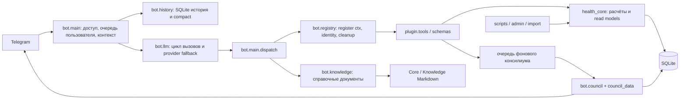

# Архитектура health-agent: согласованность ответов и поиск

Дата: 7 ноября 2026, Asia/Yekaterinburg. Тип работы: `AUDIT_ANALYSIS` с локальными исправлениями.

## Вывод

Разделение SQLite → детерминированное Python-ядро → инструменты → LLM соответствует задаче. Основная проблема качества находится на границах: разные алгоритмы называют разные состояния «плато», инструкции подсказывают причинные объяснения без достаточных данных, а история сохраняет прошлые интерпретации. Замена модели или добавление ещё одного агента сами по себе эти причины не устраняют.

Приоритет — единая оценка динамики с явным состоянием «недостаточно данных», актуальные сведения через инструменты и проверяемый контракт выдачи. Для текущего небольшого развёртывания SQLite и модульный Python подходят; оснований вводить микросервисы, внешнюю векторную БД или обязательный консилиум на каждый вопрос не обнаружено.

## Границы доказательств

- Исследован код и локальные тесты. Персональные данные не передавались в открытые источники или внешние модели, секреты не читались, работающие сервисы не перезапускались.
- Полного лога конкретного разговора, где бот сменил объяснение с плато на пищевые привычки, в доступном checkout нет. Поэтому ниже подтверждаются дефекты, допускающие такую смену, а не точная последовательность событий в том разговоре.
- Высокая уверенность означает прямое подтверждение кодом или регрессией. Средняя — правдоподобное влияние подтверждённого дефекта на качество реальных ответов без доступной трассы инцидента.
- Проверки с подменой LLM доказывают поведение кода. Они не измеряют долю верных ответов реальной модели. Численные оценки качества prompt, ускорения, экономии токенов и clinical accuracy не назначались без измерений.
- В рабочем дереве уже были пользовательские изменения в `config.yaml`, `health_core/energy.py`, `health_core/forecast.py`, `plugin/tools.py` и дополнительные локальные документы. Они не откатывались. Исправления к `forecast.py` добавлялись поверх существующего состояния.
- Метод `analyze-project` применён к доказательствам, root cause, приоритетам и уверенности. Несвязанные Antigravity-сессии не сканировались; метрики завершения чужих сессий и достаточности их opening prompts не выдумывались.

## Фактическая структура

Сильные стороны:

- Пользователь определяется через `ContextVar`; `asyncio.to_thread` переносит этот контекст к синхронным хендлерам. Есть регрессии межпользовательской изоляции.
- Блокирующая работа инструментов вынесена с event loop; пользовательский lock защищает порядок диалога, не ставя всех пользователей в одну очередь.
- `registry.dispatch` гарантирует cleanup соединений; есть отдельные проверки записей и ошибок инструментов.
- Фоновые аналитики и судья не блокируют обычный ответ. Последовательный запуск аналитиков осознанно ограничивает нагрузку на общую квоту, а анонимизация порядка снижает один из источников предвзятости судьи.
- Медицинская арифметика и сохранение фактов находятся в Python и SQLite; LLM выбирает инструменты и объясняет результаты.

`SPEC.md` описывает ранний Hermes runtime, тогда как текущий рабочий вход — собственный aiogram-бот. Эта документационная разница мешает сопровождению: топологию и эксплуатационные инструкции стоит сверять с актуальным `bot/main.py` и `DEPLOY.md`.

## Причины противоречий и приоритеты

| Приоритет | Наблюдение и доказательство | Последствие | Уверенность |
|---|---|---|---|
| P1 | До исправления `forecast.plateau_forecast`, `guards.check_plateau` и `council_data.plateau_3w` использовали разные окна и критерии | Один вопрос через разные инструменты мог получить разные ярлыки плато | Высокая: код; влияние на конкретный разговор не подтверждено |
| P1 | Прежний `[ПЛАТО]` в `Core/system_promt.md` предписывал при стоящей талии объяснять ситуацию недооценкой порций; старое пояснение `forecast` предлагало адаптацию | LLM получала конкурирующие причины, хотя наблюдения не устанавливают ни одну из них | Высокая: прямые инструкции |
| P1 | Количество взвешиваний принималось за временное покрытие, не везде отделялись утренние значения и повторные измерения одного дня | Внутридневной шум или скопление точек могли имитировать длительный застой | Высокая: алгоритмы и новые синтетические регрессии |
| P1 | `run_loop` возвращал `last_text` при исчерпании числа итераций, включая текст до получения результата последнего инструмента и reasoning | Предварительная гипотеза могла показываться как проверенный ответ | Высокая: воспроизводится подменой ответа провайдера |
| P2 | `knowledge` игнорировал `query` у файлов до 20 KiB, у больших искал только точную подстроку, а один большой абзац мог обойти бюджет 8 KiB | Релевантный материал терялся или весь документ занимал контекст вместо нужного фрагмента | Высокая: сравнение исходного и исправленного кода на синтетическом корпусе; реальный recall не измерен |
| P2 | Старые tool JSON остаются в истории; `/compact` запрещал пересказывать числа, но не медицинские интерпретации | Ошибочное объяснение могло пережить сжатие и влиять на следующий ответ | Высокая: механизм; средняя: частота проявления |
| P2 | В описании `forecast` не было `plateau`, а `refeed` обещал автоматический MATADOR 2/2 вопреки системным правилам | Модели труднее выбрать нужный action; правила конфликтовали уже на уровне каталога tools | Высокая: строки `bot/registry.py` |
| P2 | `bot.main._run_council_task` отправляет итог в Telegram без добавления в `chat_history` | Следующий обычный ход не видит текст, который человек уже получил, пока не прочитает `council status` | Высокая: код; средняя: вклад в инцидент |
| P2 | `council_data.build` прежде отдавал сырые тренды и талию без общего актуального заключения | Каждый аналитик мог заново определять плато; судья агрегировал интерпретации | Высокая: пакет данных |
| P3 | 39 пользовательских tools, большие схемы, несколько пересекающихся вариантов сводки; общий timeout отсутствует, есть timeout отдельного HTTP | Лишние вызовы и большие задержки возможны при fallback и повторных шагах | Высокая: структура; экономия после оптимизации не измерена |

Корневая причина — `REPO_FRAGILITY`: отсутствие общего контракта интерпретации при наличии нескольких читателей одних данных. Вторичная причина — ошибки правил агента: причинные выводы были зашиты в prompt без достаточных доказательств. Недостатки пользовательского запроса не являются объяснением: требование согласованного ответа по одним данным относится к базовому контракту бота. Полная трасса нужна, чтобы отличить использование устаревших результатов от выбора конфликтующего инструмента в конкретном разговоре.

## Принятые изменения

1. Единая детерминированная оценка динамики в `health_core/plateau.py`, которую используют прогноз, гард и проверка консилиума. Оценка различает уменьшение/увеличение веса, короткую паузу, длительное отсутствие снижения, уменьшение талии и недостаток данных. Клиническую причину такой сигнал не устанавливает.
2. Уточнение инструкций в `Core`: состояние берётся из актуального результата инструмента; пищевая причина, адаптация и задержка воды не объявляются доказанными по одному тренду. Популяционный ориентир терапии отделяется от персонального прогноза.
3. В `bot.llm.run_loop` исчерпание лимита заканчивается явным сообщением о незавершённой проверке. Промежуточная гипотеза не становится итогом. Reasoning не подставляется вместо отсутствующего финального content и не печатается в лог целиком.
4. `bot.registry` описывает `forecast plateau` и не рекламирует автоматические циклы MATADOR. Prompt сжатия истории сохраняет предпочтения и согласованные планы, исключая производные медицинские объяснения.
5. Поиск справочных материалов расширен: `query` работает для файлов любого размера, Unicode/регистр/ё-е нормализуются, `topic: "*"` ищет по всем разрешённым темам. BM25-подобное лексическое ранжирование учитывает фразу и покрытие слов запроса. Фрагменты содержат путь источника и заголовок; итог ограничен 8192 байтами, длина запроса — 1024 байтами. Ограничения доступа сохраняются. Это лексический поиск без семантической модели и русского стемминга. Нормализация имён NFC/NFD повышает переносимость: на текущем macOS само разрешение такого имени работало и до исправления.
6. Интерактивный `/plateau` приведён к новому контракту: показывает дату проверки, покрытие веса и фактический промежуток между замерами талии, маркирует сценарий питания, не печатает индивидуальную дату плато или обратный отсчёт до неё. Кнопка перерыва в дефиците появляется только при подтверждённом длительном операционном сигнале веса и талии.

Изменения выполнялись отдельными агентами с непересекающимся ownership; общий diff и проверки интегрирует координатор. Это локальная доработка, не выкладка и не подтверждение изменения уже запущенного процесса.

## Почему трактовка плато изменилась

В анализе SURMOUNT-1/SURMOUNT-4 plateau определяли как изменение массы менее 5% за 12-недельный интервал с сохранением до конца наблюдения. Это критерий исследования, а не способ диагностировать причину двухнедельной паузы у отдельного человека. Перенос медианного срока группы на дату персонального «фармакологического плато» даёт ложную точность. Поэтому короткие окна приложения следует называть операционными сигналами динамики и сопровождать покрытием данных. [Исходная публикация SURMOUNT](https://pmc.ncbi.nlm.nih.gov/articles/PMC12096058/)

Тот же принцип применим к талии: наблюдаемое уменьшение может быть дополнительным сигналом, но само по себе не доказывает точную потерю жира и не определяет задержку воды. Пищевой дневник содержит записанное питание, а отсутствие записи означает неизвестность; оно не доказывает ни голодание, ни переедание, ни «неправильные привычки».

## Следующие оптимизации

| Шаг | Конкретное изменение | Польза | Стоимость / ограничение | Критерий проверки |
|---|---|---|---|---|
| 1 | Ввести envelope read-инструментов: `as_of`, окно, число уникальных дней, coverage, freshness, status, version алгоритма | Модель видит, что проверено и чего не хватает; проще расследовать расхождения | Средняя: менять контракты постепенно, сохраняя текущие поля | Все ответы о динамике называют одно состояние при одинаковом snapshot |
| 2 | Добавить банк синтетических диалогов с реальными вариантами формулировок, ошибками, устаревшей историей и повторными вопросами | Измерение качества модели отдельно от арифметики и транспорта | Средняя; реальные model runs требуют квоты, только синтетические данные | Проверять выбор read tools, faithfulness, consistency, отсутствие unsupported causes, p50/p95 latency, calls/tokens |
| 3 | При ссылке на консилиум вызывать `council status`; фиксировать в истории служебный факт завершения с run_id и временем | Закрывает разрыв между Telegram и контекстом LLM | Низкая/средняя; не переносить выводы как вечные факты | Последующий вопрос получает актуальный результат нужного run |
| 4 | Ограничить общий wall-clock budget хода поверх timeout HTTP и fallback | Предсказуемее время ответа при сбоях | Средняя; timeout не должен терять сведения о выполненных записях | Fault tests: медленные провайдеры/инструменты, user sees incomplete state, no duplicate writes |
| 5 | Постепенно выделять read models и transport renderers из `plugin/tools.py` и `bot/main.py` | Меньше копирования SQL/критериев, проще тестировать без Telegram | Средняя/высокая; только по затрагиваемым сценариям | Все старые entry points используют один reader, без новой копии логики |
| 6 | Замерить размер каталога tools и контекста; выбирать подмножество по стабильным сценариям только после eval | Возможное сокращение токенов и ошибочных вызовов | Средняя; преждевременная маршрутизация может скрыть нужный tool | Сравнение с baseline на одном наборе запросов и повторных trials |
| 7 | При росте Knowledge рассмотреть локальный FTS5, затем гибридный поиск, если lexical recall недостаточен | Масштабирование поиска без сетевой зависимости | Сначала нужен corpus/query benchmark; русский стемминг не возникает автоматически | Recall@k/MRR по размеченным synthetic queries и проверка ACL |
| 8 | Синхронизировать `SPEC.md` с aiogram runtime, отметить архивные решения | Сопровождение следует актуальной системе | Низкая; не менять исторические ADR задним числом | Новый разработчик находит единственную актуальную схему запуска |

Предлагать векторную БД только после провала измеримого baseline. Вес, питание и препараты требуют структурированных SQL-readers и дат, а не поиска похожих фрагментов. Справочные материалы — отдельный корпус, для которого можно сравнить лексический, FTS5 и гибридный поиск.

## Проверка и оставшиеся ограничения

- Добавлены offline-регрессии для предварительного content/reasoning при исчерпании лимита и финального reasoning без content. Проверяют не фразы модели по вероятности, а контракт возврата и сохранение результата инструмента.
- Добавлены сценарии плато на синтетической временной SQLite и сценарии поиска на временных Markdown-файлах. Проверяются повторные взвешивания одного дня, редкие крайние точки окна, отсутствие талии, снижение талии, исключение вечерних/будущих точек и дней рефида, а также возобновление роста/снижения при одинаковых медианах двух недель.
- Итоговая проверка координатора на финальном коде: `test_bot.py` — **69 пройдено, 0 ошибок**; `test_e2e.py` — **все 10 этапов пройдены**.
- Самопроверки `python -m bot.llm`, `python -m bot.knowledge`, `python -m health_core.council_data` завершились успешно. Использован отдельный `/tmp/health-agent-review-venv/bin/python` (Python 3.14.9), установлены зависимости из `requirements.lock`; штатная `.venv` ссылалась на нерабочий Xcode Python. Проектная среда не перенастраивалась.
- `git -c core.whitespace=cr-at-eol diff --check` прошёл. Координатор сравнил с исходным diff пользовательские `config.yaml`, `health_core/energy.py`, `plugin/tools.py`: их прежние изменения сохранены без дополнительных правок этой работы.
- Сравнение исходного `bot/knowledge.py` из Git HEAD и исправленной версии на 11 синтетических проверках контракта: 5/11 → 11/11. Это не production accuracy и не оценка LLM; проверены query/filtering, многословный поиск, лимит байтов, ACL и актуализация файлов.
- Старый `test_forecast_calibrate` предполагал фиксированный пол 1799 ккал, несовместимый с уже существовавшими пользовательскими правками политики. Регрессия теперь выбирает цель ниже/выше фактически вычисленного пола и сохраняет проверки предупреждения, `safe` и применения срока; расчёты пользователя не откатывались.
- Реальные model-evals и измерение времени ответа production не выполнялись; утверждать количественное улучшение ответов нельзя.
- Обычный текст LLM пока не проходит полноценную структурированную проверку всех медицинских утверждений. Единые вычисления и непротиворечивые правила сокращают риск, но не дают гарантии отсутствия галлюцинаций.
- Общая оценка плато изолирует сопоставимые наблюдения, но не унифицирует все входы прочих расчётов: `forecast.smoothed_weight` и расчёт расхода требуют отдельного аудита времени, свежести и допускаемых измерений. Исправление статуса плато не означает, что любой прогноз или TDEE использует тот же набор точек.
- Новый prompt `/compact` действует при следующем сжатии. Ранее сохранённые сводки не переписывались; свежая проверка инструмента остаётся обязательной.
- Полный запрет причинных догадок должен действовать и в консилиуме. Единогласие моделей не превращает гипотезу в доказательство.

## Открытые источники и применимость

- [SURMOUNT: time to weight plateau](https://pmc.ncbi.nlm.nih.gov/articles/PMC12096058/): определение plateau и популяционный характер анализа; не источник индивидуального диагноза.
- [Anthropic: Writing effective tools for agents](https://www.anthropic.com/research/writing-tools-for-agents): выбирать инструменты по задачам, возвращать осмысленный контекст, оценивать реальные сценарии и расходы calls/tokens/runtime. Поддерживает улучшение контрактов и каталога, не доказывает ускорение данного репозитория.
- [Anthropic: Demystifying evals for AI agents](https://www.anthropic.com/research/demystifying-evals-for-ai-agents): различать финальное состояние и текст обещания, проверять траекторию, повторять trials, разделять capability и regression suites. Поддерживает roadmap синтетического eval-банка.
- [SQLite FTS5](https://www.sqlite.org/fts5.html): локальный полнотекстовый индекс, ранжирование и токенизация; возможный следующий шаг после измерения текущего поиска.
- [Anthropic: Contextual Retrieval](https://www.anthropic.com/research/contextual-retrieval): сохранение контекста фрагмента и сочетание лексического/семантического поиска. Публикационные проценты улучшения не переносились на этот проект.

Веб-запросы содержали только общие технические и научные термины. Сам факт публикации рекомендации не заменяет её проверку на текущем окружении и данных.
